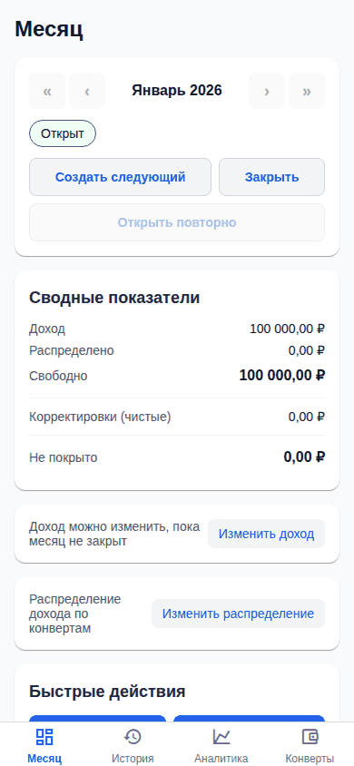
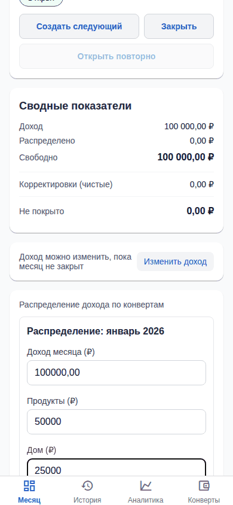
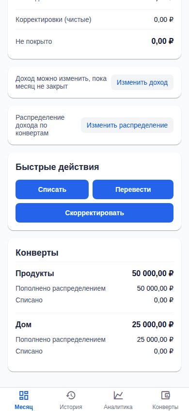
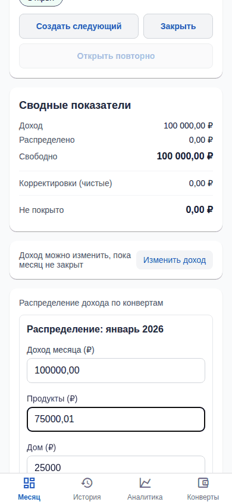
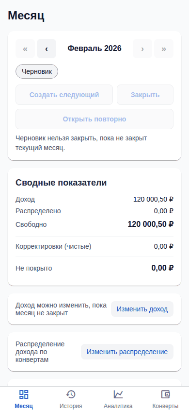
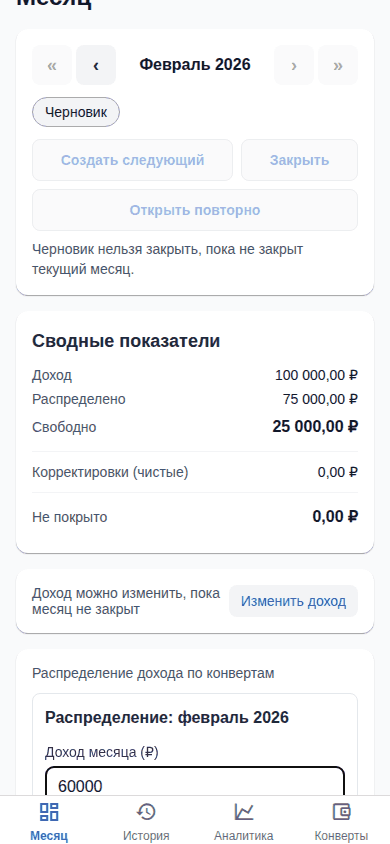
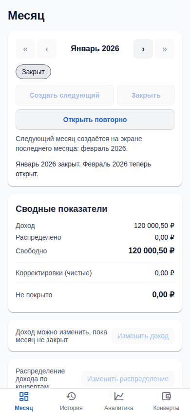
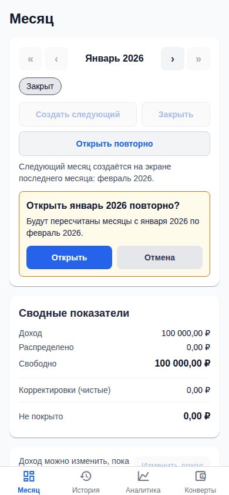
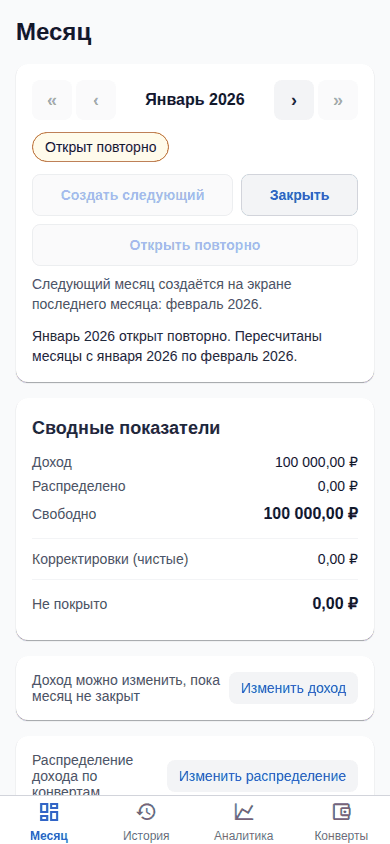

# Отчёт по вехе E-03. Экран «Месяц» и редактор распределения

Дата: 2026-11-01. Эпик: [`epics/E-03-month-screen.md`](../../epics/E-03-month-screen.md). Статус эпика: `planned` → `accepted` (принято владельцем 2026-11-01).

## Итог

Все три задачи эпика (T-009, T-010, T-037) смёржены в `master`. Вкладка «Месяц» показывает реальные данные API: переключатель периода, статус, сводку (доход, распределено, свободно), список конвертов и действия «создать первый/следующий месяц», «закрыть», «открыть повторно» (с показом диапазона пересчёта до подтверждения). Редактор распределения держит итог и «свободно» на виду и блокирует сохранение с точным превышением. Сценарии E-03 автоматически проходят в браузере (Expo web, Playwright), скриншоты приложены ниже.

## Смёрженные PR

| Задача | PR | Что сделано |
|--------|----|-------------|
| T-009 | [#23](https://github.com/Web-Usov/home-finances/pull/23) | Вкладка «Месяц»: дашборд (`GET /dashboard/monthly`), `PeriodSwitcher` (только месяц), статус, `SummaryCard`, `EnvelopeRow`, быстрые действия (отключены в закрытом месяце с текстом MSG-06), форма первого месяца, создание следующего, закрытие, повторное открытие |
| T-010 | [#24](https://github.com/Web-Usov/home-finances/pull/24) | Редактор дохода и распределения: по строке на активный конверт, «распределено» и «свободно» всегда на экране (знак сохраняется), блокировка сохранения при превышении с точной суммой (MSG-01); одно атомарное сохранение дохода и распределения |
| T-037 | [#37](https://github.com/Web-Usov/home-finances/pull/37) | Подтверждение повторного открытия показывает диапазон пересчёта до подтверждения (`GET /months/:period/reopen-preview`, MON-12, AC-15) |

Влияющие задачи других эпиков: T-041 ([#47](https://github.com/Web-Usov/home-finances/pull/47), новый месяц копирует доход предыдущего), T-048 ([#43](https://github.com/Web-Usov/home-finances/pull/43), конверты с вкладки «Конверты» сразу видны в редакторе), T-050 ([#46](https://github.com/Web-Usov/home-finances/pull/46), версия через `If-Match`/`ETag`).

## Покрытие правил и AC

`pnpm spec:check --verbose`: из 21 правила эпика **19 имеют ссылки из тестов, 2 без ссылок**:

| Правило | Статус | Комментарий |
|---------|--------|-------------|
| `UI-01` | не покрыто тестом по ID | Стартовый экран — месячный дашборд, нижняя навигация на телефоне. Реализовано (вкладка «Месяц» открывается первой, все e2e стартуют с неё), но ссылки на ID в тестах нет |
| `UI-15` | не покрыто тестом по ID | Изменение распределения пересчитывает уже добавленные операции этого и последующих месяцев. Пересчёт выполняет API (тесты каскада E-01), UI-теста со ссылкой на ID нет |
| Остальные 19 (`UI-02`, `UI-06`…`UI-14`, `MSG-01`, `MSG-06`, `SCOPE-23`, `SCOPE-25`, `SCOPE-26`, `SCOPE-29`, `MON-12`, `FIN-02`, `NFR-20`) | покрыто ссылками | см. таблицу ниже |

AC эпика:

| AC | Тесты |
|----|-------|
| AC-01 | `first-launch.e2e.ts`, `month-dashboard.e2e.ts`, `FirstMonthForm.test.tsx`, `acceptance.mvp-scenarios.int-spec.ts` |
| AC-02 | `allocation-editor.e2e.ts`, `AllocationEditor.test.tsx`, `reporting.monthly-dashboard.int-spec.ts` |
| AC-03 | `allocation-editor.e2e.ts`, `AllocationEditor.test.tsx`, `allocation.test.ts`, `acceptance.mvp-scenarios.int-spec.ts` |
| AC-04 | `allocation-editor.e2e.ts`, `AllocationEditor.test.tsx`, `acceptance.mvp-scenarios.int-spec.ts` |
| AC-14 | `month-dashboard.e2e.ts`, `correct-the-past.e2e.ts`, `months.close-reopen.int-spec.ts` |
| AC-15 | `month-dashboard.e2e.ts` (диапазон до подтверждения), `correct-the-past.e2e.ts`, `months.close-reopen.int-spec.ts` |
| NFR-20 (360 px) | untagged-тест раскладки 360 px в `month-dashboard.e2e.ts` |

(`UI-01` и `UI-15` нужно привязать к тестам по ID: это находка для следующей задачи, дефектов поведения не обнаружено.)

## Результаты проверок

| Проверка | Результат |
|----------|-----------|
| `pnpm spec:check` | OK |
| `pnpm verify` | PASSED (206 с; юнит API 327 и mobile 130, интеграционные 282), см. [E-06](E-06-report.md) |
| `pnpm e2e:full` | см. раздел «Результат e2e» в [отчёте E-06](E-06-report.md#результат-e2e-full) |

## Демо-сценарий «Критерии приёмки вехи» и скриншоты

Стенд: http://192.168.1.114:8100/ (вкладка «Месяц»). Скриншоты ниже сняты тестами e2e на пустой тестовой базе при ширине 390 px; кадр равен видимой области экрана (длинные экраны прокручиваются внутри окна), поэтому часть текста может быть ниже кадра. Чтобы повторить на чистой базе, используйте Docker Compose из `README.md` (порт 8080).

**1. Чистая база → первый месяц, доход 100 000 ₽ → «Открыт» (`AC-01`).** Ожидается: пустое состояние с формой первого месяца; после ввода месяц со статусом «Открыт» и доходом 100 000,00 ₽.

**2. Распределить 75 000 ₽ → «Свободно 25 000 ₽» (`AC-02`).** Ожидается: в редакторе «Распределено» и «Свободно» обновляются по мере ввода; после сохранения на дашборде «Свободно 25 000,00 ₽».

**3. Распределение 100 000,01 ₽ → сохранение заблокировано, превышение 0,01 ₽ (`AC-03`).** Ожидается: показано «Распределено на 0,01 ₽ больше дохода. Уменьшите суммы по конвертам.», кнопка «Сохранить распределение» неактивна, на сервере распределение осталось прежним. На скриншоте виден введённый 75 000,01 ₽ в строке «Продукты» (кадр обрезан по окну, текст превышения ниже видимой части; он проверяется утверждением теста `AC-03`).

**4. Следующий месяц → распределение скопировано как черновик (`AC-04`).** Ожидается: черновик со скопированным распределением и (после T-041) скопированным доходом.

**5. Закрыть месяц → изменения отключены, «Месяц закрыт…» (`AC-14`); открыть повторно с предупреждением о диапазоне пересчёта (`AC-15`).** Ожидается: у закрытого месяца кнопки «Закрыть», «Изменить доход», «Изменить распределение» недоступны, ниже видна подсказка «Месяц закрыт. Откройте его повторно, чтобы внести изменения.» (MSG-06; на скриншоте видны отключённые кнопки, текст MSG-06 проверяется утверждением теста); в окне «Открыть январь 2026 повторно?» до подтверждения виден диапазон «Будут пересчитаны месяцы с января 2026 по февраль 2026.»; после подтверждения статус «Открыт повторно».

**6. На ширине 360 px нет горизонтальной прокрутки страницы (`NFR-20`).** Ожидается: страница не прокручивается по горизонтали. Проверяется автотестом `month-dashboard.e2e.ts` (360 px) без скриншота. Вручную: уменьшить окно браузера до 360 px.

**7. Скриншоты e2e приложены** (выше). Полный отчёт Playwright: артефакт CI `playwright-report-full` (workflow `e2e-full`, запускается на каждый push в `master`) и `playwright-report` (смоук в каждом PR).

## Известные ограничения и риски

- `UI-01`, `UI-15` не имеют ссылок из тестов (см. выше).
- Горизонтальная прокрутка проверена автотестом на 360 px только для вкладки «Месяц»; остальные экраны проверены в своих эпиках (аналитика: E-05).
- Тексты, отсутствующие в спеке (подсказки для черновика и закрытого месяца, уведомления после действий), написаны разработчиком и не согласованы с владельцем.
- Новый черновик без дохода (создан до T-041) показывает отрицательное «Свободно»; это ожидаемо (FIN-11), новые месяцы доход копируют.
- Диапазон в превью повторного открытия консультативный: между превью и подтверждением состояние может измениться, `reopen` перепроверяет под блокировкой.

## Что проверить человеку

1. Пройти шаги 1–6 на стенде http://192.168.1.114:8100/ (вкладки «Месяц» и «Конверты»); стенд содержит демо-данные, чистое состояние проверяется через Docker Compose.
2. Просмотреть скриншоты выше и убедиться, что тексты на русском читаются.
3. Убедиться, что CI на PR зелёный.
4. Принять веху: в `epics/E-03-month-screen.md` поставить `status: accepted` и `accepted: YYYY-MM-DD`.

Принято владельцем 2026-11-01 (PR #53, пройден пользовательский сценарий на стенде).
