# Отчёт по вехе E-04. Операции и история (UI)

Дата: 2026-11-01. Эпик: [`epics/E-04-operations-ui.md`](../../epics/E-04-operations-ui.md). Статус эпика в этом PR: `planned` → `done`.
Статус `accepted` ставит только владелец.

## Итог

Обе задачи эпика (T-011, T-012) смёржены в `master`. Быстрые действия «Списать», «Перевести», «Скорректировать» открывают формы только с месяцем (без поля дня), показывают доступный остаток, предупреждают о нехватке денег и сохраняют операцию с непокрытой частью после подтверждения. Вкладка «История» показывает операции месяца в порядке добавления, фильтрует по конверту и типу, позволяет изменить и удалить операции в незакрытых месяцах и только показывает их в закрытых. Сценарии AC-05…AC-13 и AC-21 автоматически проходят в браузере, скриншоты приложены.

## Смёрженные PR

| Задача | PR | Что сделано |
|--------|----|-------------|
| T-011 | [#35](https://github.com/Web-Usov/home-finances/pull/35) | Формы списания, перевода и корректировки (±): доступный остаток конверта, предупреждение «Всё равно сохранить» при нехватке (OP-06, OP-12), при переводе сверх остатка предложение «Перевести только X» (OP-07, MSG-03), результат с непокрытой частью из ответа API (MSG-02/MSG-04); запрос идёт в показанный месяц; в закрытом месяце формы отключены (MSG-06) |
| T-012 | [#39](https://github.com/Web-Usov/home-finances/pull/39) | Вкладка «История»: переключатель месяца, фильтры по конверту и типу, строки в порядке `sequence_no` с покрытой и непокрытой суммой (янтарная строка и текст «⚠ Не покрыто»), правка и удаление с подтверждением, стартовые остатки без кнопок (OP-10), закрытый месяц только для чтения (HIST-10) |

Влияющие задачи других эпиков: T-025 ([#31](https://github.com/Web-Usov/home-finances/pull/31), `period` в `POST /operations`), T-045 ([#49](https://github.com/Web-Usov/home-finances/pull/49), фильтры детализации и чип «Только непокрытые» в истории), T-048 ([#43](https://github.com/Web-Usov/home-finances/pull/43)), T-050 ([#46](https://github.com/Web-Usov/home-finances/pull/46), `If-Match` вместо `version`).

## Покрытие правил и AC

`pnpm spec:check --verbose`: из 21 правила эпика **17 имеют ссылки из тестов, 4 без ссылок**:

| Правило | Статус | Комментарий |
|---------|--------|-------------|
| `HIST-01` | не покрыто тестом по ID | Месяц операции, точной даты нет. Реализовано (в форме и истории только месяц; AC-21 покрыт), но ссылки на ID в тестах нет |
| `HIST-02` | не покрыто тестом по ID | Тип операции в списке; ссылки на ID нет |
| `HIST-03` | не покрыто тестом по ID | Конверт-источник и получатель в строке истории; ссылки на ID нет |
| `HIST-04` | не покрыто тестом по ID | Запрошенная, покрытая и непокрытая суммы; поведение проверяет `history.e2e.ts` (AC-08/HIST-11), но без ссылки на `HIST-04` |
| Остальные 17 (`UI-03`, `UI-10`, `HIST-05`, `HIST-07`…`HIST-12`, `OP-06`, `OP-07`, `OP-12`, `OP-13`, `MSG-02`…`MSG-04`, `MSG-06`) | покрыто ссылками | |

Это пробел в ссылках на ID, а не в поведении: колонки истории (`HIST-01`…`HIST-04`) видны на скриншотах. Рекомендуется отдельная маленькая задача на привязку тестов.

AC эпика:

| AC | Тесты |
|----|-------|
| AC-05, AC-06, AC-07, AC-09, AC-10 | `operations.e2e.ts`, `OperationForm.test.tsx` |
| AC-12, AC-13 | `history.e2e.ts` |
| AC-21 | `operations.e2e.ts`, `journeys/no-day-field.e2e.ts`, `OperationForm.test.tsx`, `HistoryView.test.tsx` |

## Результаты проверок

| Проверка | Результат |
|----------|-----------|
| `pnpm spec:check` | OK |
| `pnpm verify` | PASSED (206 с; юнит API 327 и mobile 130, интеграционные 282), см. [E-06](E-06-report.md) |
| `pnpm e2e:full` | 24 passed; подробности в [отчёте E-06](E-06-report.md#результат-e2e-full) |

## Демо-сценарий «Критерии приёмки вехи» и скриншоты

Стенд: http://192.168.1.114:8100/ (вкладки «Месяц» и «История»). Скриншоты сняты тестами e2e на пустой базе при ширине 390 px; кадр равен видимой области экрана.

**1. Списание 3 000 ₽ из 10 000 ₽ → остаток 7 000 ₽ (`AC-05`); списание 15 000 ₽ → предупреждение, после подтверждения не покрыто 5 000 ₽ (`AC-06`).** Ожидается: «Списание сохранено.», остаток «Продукты» 7 000,00 ₽. Для 15 000 ₽ перед сохранением: «В конверте доступно 10 000,00 ₽. Остальная часть будет отмечена как непокрытая.» и кнопка «Всё равно сохранить»; после неё «Не покрыто: 5 000,00 ₽».

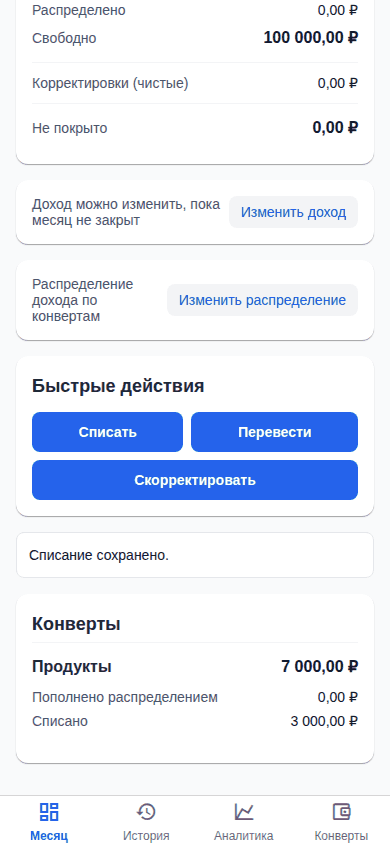
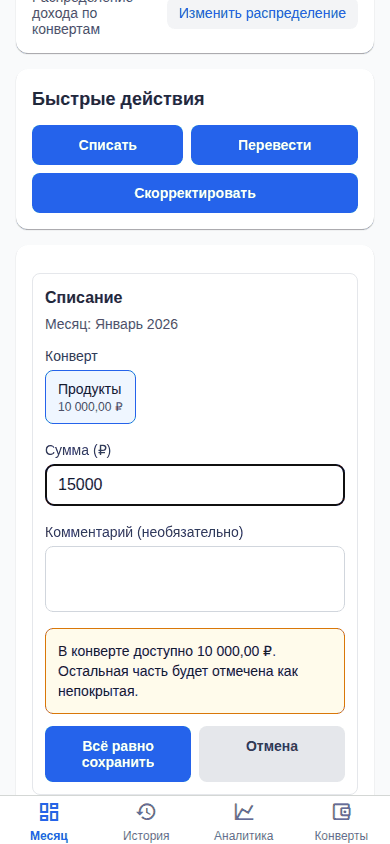
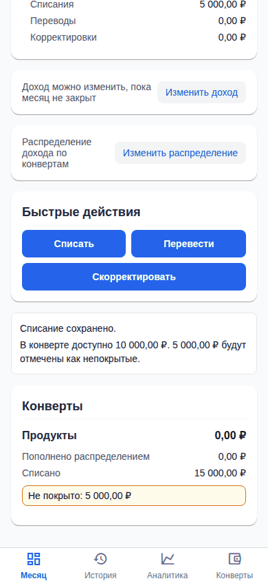

**2. Перевод 10 000 ₽ при остатке 6 000 ₽ → предложено перевести 6 000 ₽ (`AC-07`).** Ожидается: «Доступно 6 000,00 ₽. Перевести только 6 000,00 ₽?»; по нажатию «Перевод сохранён.».

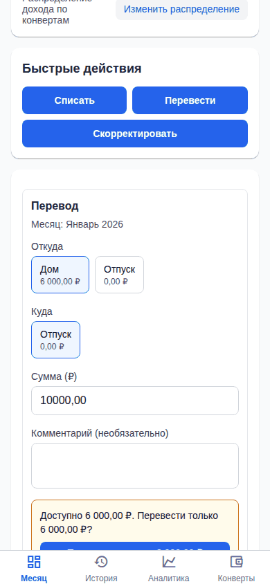
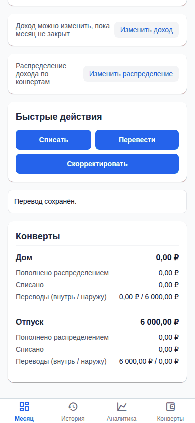

**3. Корректировки +5 000 ₽ и −15 000 ₽ (`AC-09`, `AC-10`).** Ожидается: после +5 000 остаток 15 000,00 ₽; для отрицательной корректировки больше остатка предупреждение «Баланс станет 0,00 ₽», после сохранения баланс 0 и 10 000,00 ₽ отмечены как непокрытые (пример теста: остаток 15 000, корректировка −25 000).

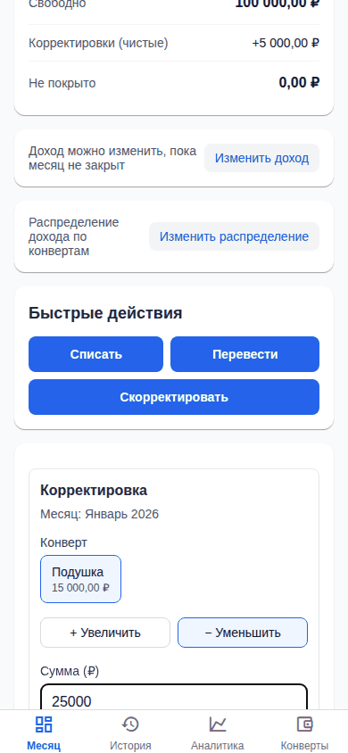
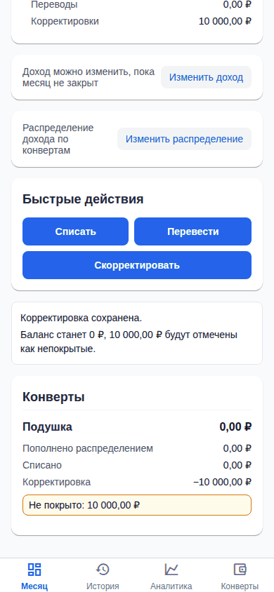

**4. История: фильтр по конверту и типу; изменить первую операцию — порядок не изменился (`AC-12`); удалить — балансы обновились (`AC-13`).** Ожидается: список в порядке добавления, номер изменённой операции прежний, после удаления строка исчезает, итоги и непокрытые части пересчитаны.

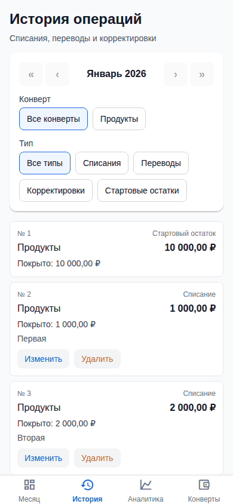
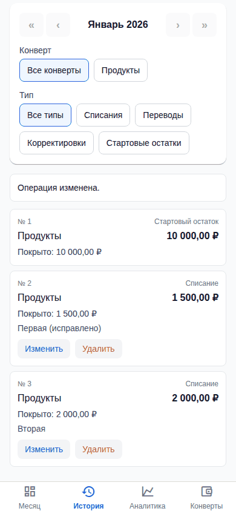
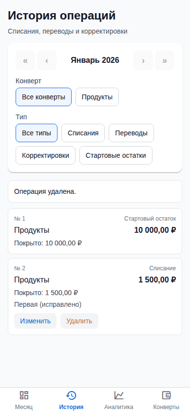
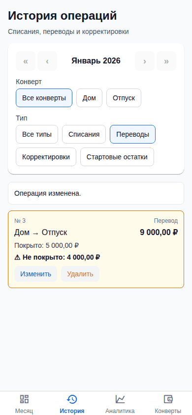

В закрытом месяце история только для чтения (HIST-10, MSG-06), быстрые действия отключены:

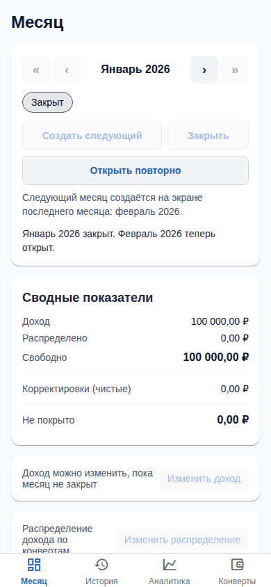

**5. В формах нет поля дня, только месяц (`AC-21`).** Ожидается: в форме списания и в форме правки операции подпись «Месяц: Январь 2026», поля даты и дня нет.

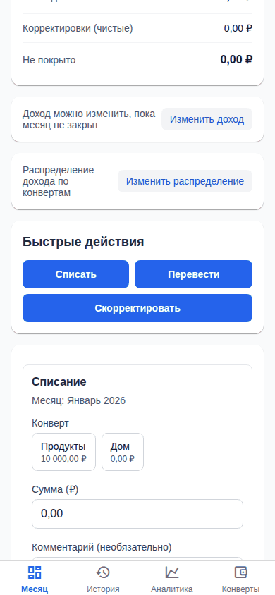
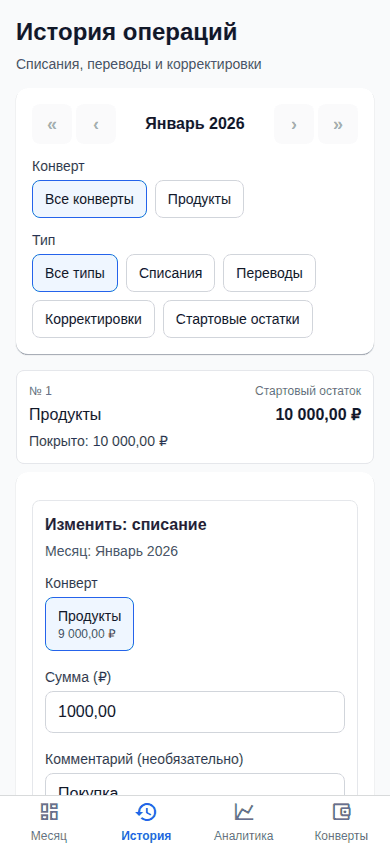

**6. Скриншоты e2e приложены** (выше); полный набор: артефакты CI `playwright-report` (смоук в каждом PR) и `playwright-report-full` (все сценарии после слияния в `master`).

## Известные ограничения и риски

- `HIST-01`…`HIST-04` без ссылок из тестов (см. выше).
- Предупреждение **до** сохранения сокращённое: «В конверте доступно X ₽. Остальная часть будет отмечена как непокрытая.» Дословный текст MSG-02/MSG-04 с суммой Y показывается **после** сохранения из ответа API: клиент не считает остатки сам (решение T-011).
- Отдельного выбора года в истории нет: год и месяц задаются переключателем периода, как на вкладке «Месяц» (T-012).
- Правка перевода: если последующие операции из-за правки теряют покрытие, они становятся непокрытыми, а не блокируют правку (решение T-005, E-01).
- Предупреждающие тексты вне спеки (результаты сохранения, подсказки) написаны разработчиком и не согласованы с владельцем.

## Что проверить человеку

1. Пройти шаги 1–5 на стенде http://192.168.1.114:8100/ : «Месяц» → быстрые действия, «История» → фильтры, правка, удаление.
2. Проверить, что тексты предупреждений понятны и на русском.
3. Убедиться, что CI на PR зелёный.
4. Принять веху: в `epics/E-04-operations-ui.md` поставить `status: accepted` и `accepted: YYYY-MM-DD`.
