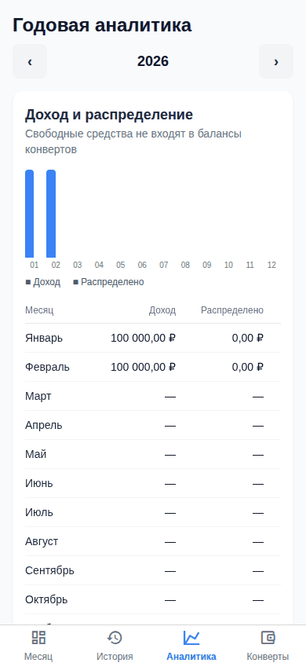
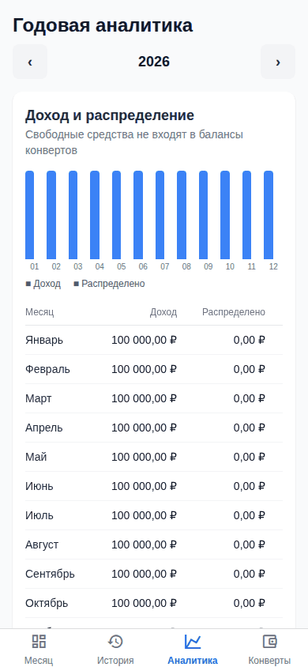
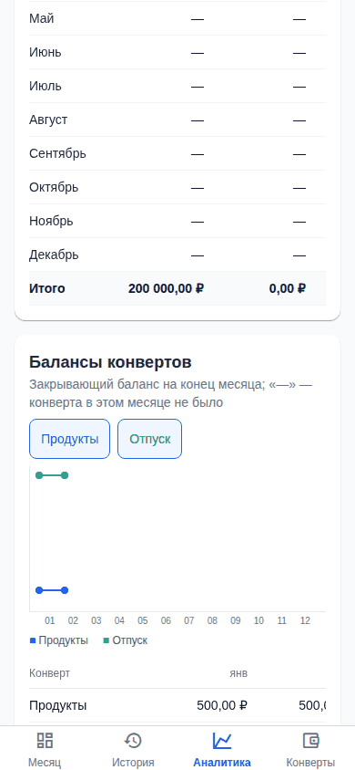
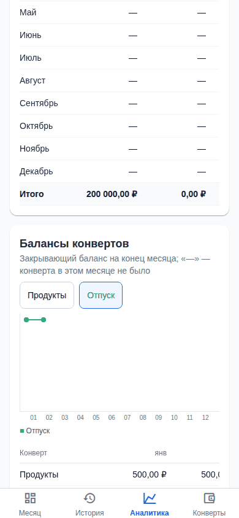
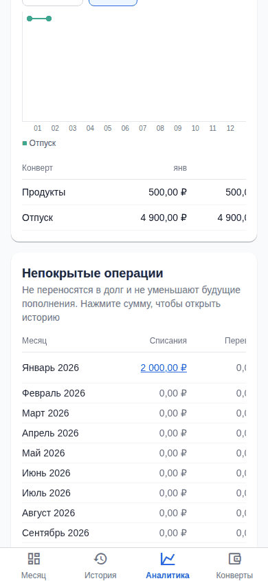
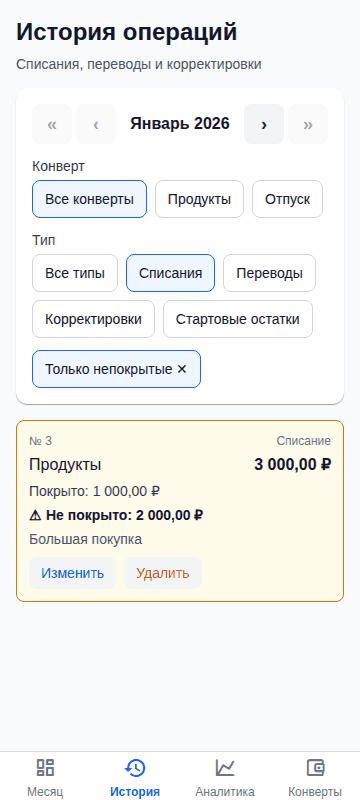
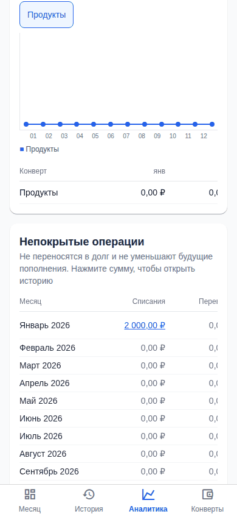
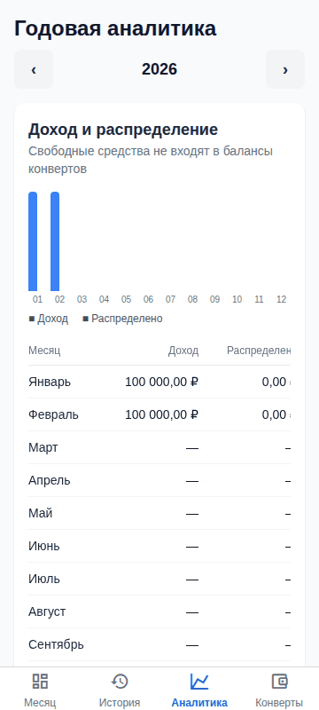
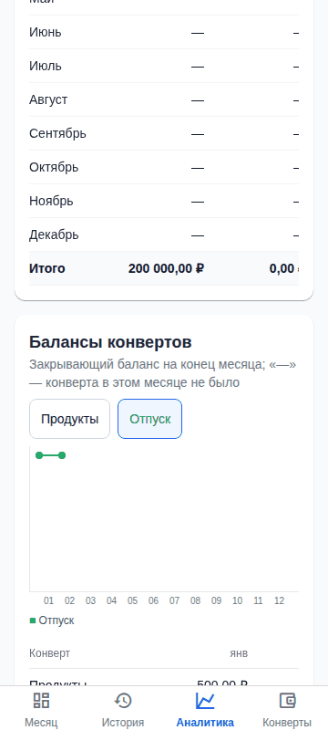

# Отчёт по вехе E-05. Годовая аналитика (UI)

Дата: 2026-11-01. Эпик: [`epics/E-05-analytics-ui.md`](../../epics/E-05-analytics-ui.md). Статус эпика в этом PR: `planned` → `done`.
Статус `accepted` ставит только владелец.

## Итог

Единственная задача эпика (T-013) смёржена в `master`; детализацию доработала T-045 (E-02). Вкладка «Аналитика» показывает выбор года и три отчёта: доход/распределено/свободно по месяцам с итогами, балансы конвертов по месяцам (график с выбором конвертов и таблица, архивные конверты помечены и переключаются) и непокрытые операции по месяцам и типам. Нажатие на непокрытую сумму открывает «Историю» с нужным фильтром. Графики нарисованы без новых зависимостей. Сценарии автоматически проходят в браузере при 390 и 360 px, скриншоты приложены.

## Смёрженные PR

| Задача | PR | Что сделано |
|--------|----|-------------|
| T-013 | [#41](https://github.com/Web-Usov/home-finances/pull/41) | Вкладка «Аналитика»: переключатель года; отчёт доходов с столбчатым графиком (REP-02) и итогами; балансы конвертов с линейным графиком и мультивыбором конвертов (REP-07), архивные конверты помечены и переключаются; непокрытые операции по месяцам и типам с разбивкой по конвертам (REP-10) и переходом в историю; на 360 px таблицы прокручиваются внутри себя, страница не прокручивается |
| T-045 | [#49](https://github.com/Web-Usov/home-finances/pull/49) | (эпик E-02) переход из отчёта открывает ровно операции, из которых сложено число: фильтры `uncoveredOnly`, `role=source`, чип «Только непокрытые» в истории |

Влияющие: T-008 ([#17](https://github.com/Web-Usov/home-finances/pull/17), API отчётов, E-02), T-041 ([#47](https://github.com/Web-Usov/home-finances/pull/47), февраль копирует доход, итог года 200 000 ₽ в тесте).

## Покрытие правил и AC

`pnpm spec:check --verbose`: из 12 правил эпика **11 имеют ссылки из тестов (`REP-01`…`REP-11` полностью), 1 без ссылок**:

| Правило | Статус | Комментарий |
|---------|--------|-------------|
| `UI-04` | не покрыто тестом по ID | Экран «Аналитика»: сменить год, выбрать конверты, открыть детализацию. Поведение проверяет `analytics.e2e.ts` (ссылки на `AC-20`/`REP-*`), но без ссылки на `UI-04` |

| AC | Тесты |
|----|-------|
| AC-20 | `analytics.e2e.ts`, `journeys/year-analytics.e2e.ts`, `reporting.yearly-analytics.int-spec.ts`, `YearlyAnalyticsView.test.tsx` |

## Результаты проверок

| Проверка | Результат |
|----------|-----------|
| `pnpm spec:check` | OK |
| `pnpm verify` | PASSED (206 с; юнит API 327 и mobile 130, интеграционные 282), см. [E-06](E-06-report.md) |
| `pnpm e2e:full` | 24 passed; подробности в [отчёте E-06](E-06-report.md#результат-e2e-full) |

## Демо-сценарий «Критерии приёмки вехи» и скриншоты

Стенд: http://192.168.1.114:8100/ (вкладка «Аналитика», год 2026; на стенде есть демо-данные за 2026-10). Скриншоты сняты тестами e2e на данных теста (январь 2026: три операции, одна из них с непокрытой частью); кадр равен видимой области экрана.

**1. На демо-данных на экране «Аналитика» доступны три отчёта (`AC-20`).** Ожидается: заголовки «Доход и распределение», «Балансы конвертов», «Непокрытые операции»; в первом по месяцам доход/распределено/свободно и итог за год (в тесте: январь 100 000,00 ₽, февраль скопирован, итог 200 000,00 ₽; месяцы без данных «—»).

**2. Фильтр активных/архивных конвертов; на графике выбираются отдельные конверты.** Ожидается: в блоке балансов переключатель архивных конвертов; выбор конвертов (чекбоксы) меняет линии графика и легенду; месяцы без конверта «—».

**3. Клик по непокрытой сумме открывает историю с нужным фильтром.** Ожидается: у января значение «2 000,00 ₽» в столбце «Списания» ссылка; по нажатию открывается «История» за этот месяц с фильтрами конверта/типа и чипом «Только непокрытые»; видны только операции с непокрытой частью (в тесте добавлены «лишние» операции: покрытое списание и плюсовая корректировка не показываются).

**Ширина 360 px** (без горизонтальной прокрутки страницы, таблицы прокручиваются внутри себя):

**4. Скриншоты e2e приложены** (выше); полный набор в артефактах CI `playwright-report` и `playwright-report-full`.

## Известные ограничения и риски

- `UI-04` без ссылки из тестов (см. выше).
- Графики самодельные (без библиотеки): столбчатый и линейный из элементов `View`; для скрин-ридеров график скрыт, источником служит таблица. Точность отображения на очень узких или широких экранах проверена только на 360 и 390 px.
- Отчёты читают снимки месяцев: месяцы без данных показываются прочерком или нулём, это ожидаемо.
- На стенде черновик 2026-11 создан до T-041 и без дохода, поэтому годовой итог дохода и «свободно» по нему выглядят занижено.

## Что проверить человеку

1. Открыть http://192.168.1.114:8100/ → «Аналитика», пройти шаги 1–3 (три отчёта, фильтр архивных и выбор конвертов на графике, клик по непокрытой сумме).
2. Проверить на ширине 360 px.
3. Убедиться, что CI на PR зелёный.
4. Принять веху: в `epics/E-05-analytics-ui.md` поставить `status: accepted` и `accepted: YYYY-MM-DD`.
