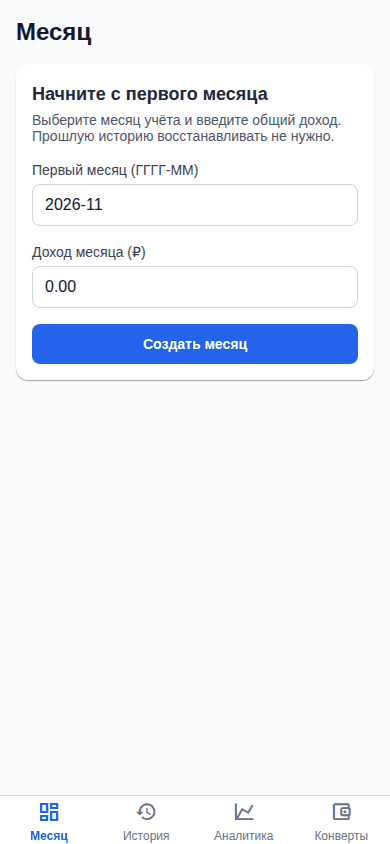
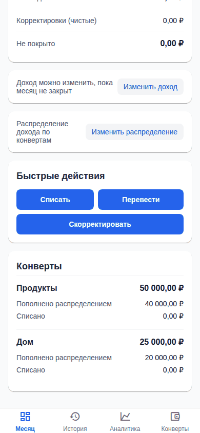
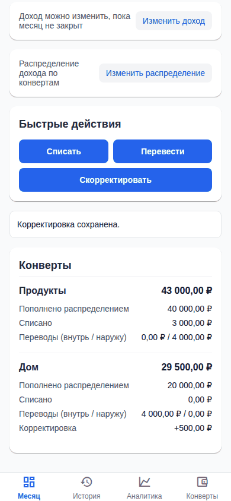
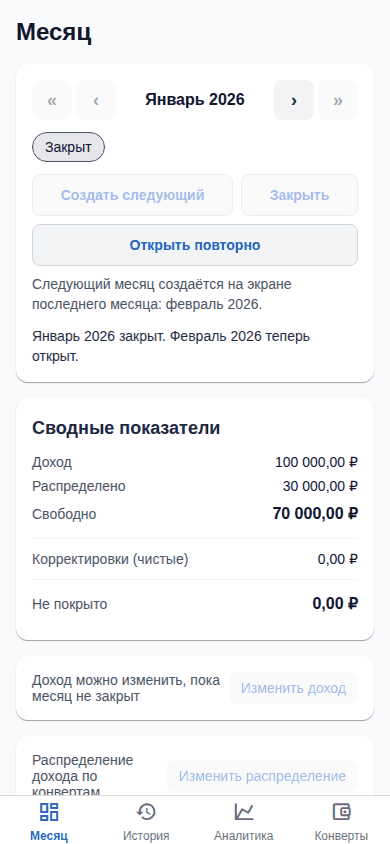
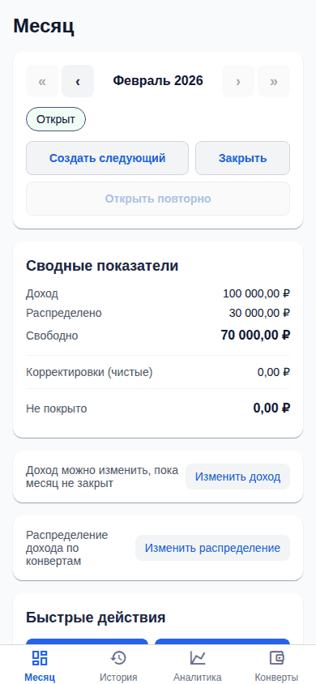
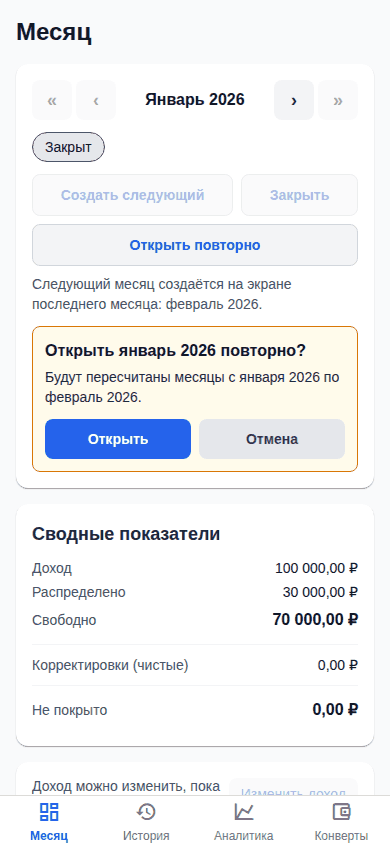
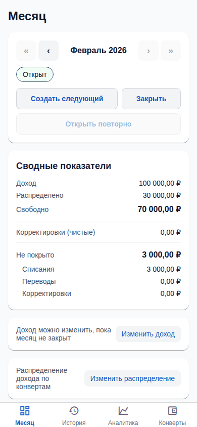
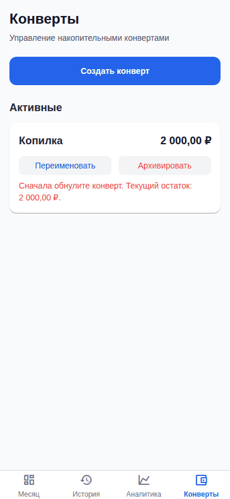
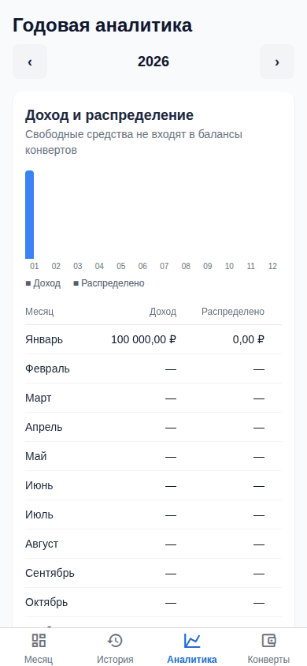

# Отчёт по вехе E-06. Приёмка MVP и поставка

Дата: 2026-11-01. Эпик: [`epics/E-06-mvp-release.md`](../../epics/E-06-mvp-release.md). Статус эпика: `planned` → `accepted` (принято владельцем 2026-11-01).

## Итог

Задачи эпика (T-014, T-015, T-016, T-038, T-039, T-048) смёржены в `master`. Все 22 сценария приёмки `AC-01`…`AC-22` имеют автотесты (`spec-check --strict-coverage` проходит с пустым списком исключений), полный e2e-прогон `pnpm e2e:full` зелёный (24 теста), стек поднимается одной командой `docker compose up -d --build`, а `pnpm smoke:compose` подтверждает, что после перезапуска всех контейнеров операции, статусы и остатки совпадают. Для ручной приёмки есть автообновляемый стенд http://192.168.1.114:8100/. Пробелы в ссылках тестов на `DOD-*` и `NFR-27`/`NFR-29` перечислены ниже.

## Смёрженные PR

| Задача | PR | Что сделано |
|--------|----|-------------|
| T-014 | [#22](https://github.com/Web-Usov/home-finances/pull/22) | Приёмочный набор `acceptance.mvp-scenarios.int-spec.ts` (HTTP + реальная БД) для AC-01, 03, 04, 14, 18, 22; все AC ссылаются на тесты; `spec-check --strict-coverage` с allowlist; ветви непокрытых сумм движка покрыты юнит-тестами (операторы 92 %, ветви 87 %) |
| T-015 | [#42](https://github.com/Web-Usov/home-finances/pull/42) | Полные пользовательские сценарии Playwright `e2e/journeys/*`: первый запуск, обычный месяц, черновик и закрытие, исправление прошлого, архивирование конверта, «нет поля дня», годовая аналитика; именованные скриншоты шагов |
| T-016 | [#40](https://github.com/Web-Usov/home-finances/pull/40) | Docker Compose: `postgres` → `migrate` → `api` → `web` (статический Expo web + прокси `/api`, один порт); `pnpm smoke:compose` с перезапуском стека (AC-22/DOD-01); README с первым запуском |
| T-038 | [#28](https://github.com/Web-Usov/home-finances/pull/28) | Стенд предпросмотра: автодеплой `master` (веб :8100, API 127.0.0.1:3100, БД `family_budget_preview`, демо-данные, systemd-таймер раз в 2 минуты, blue/green) |
| T-039 | [#34](https://github.com/Web-Usov/home-finances/pull/34) | Стенд не падает: `Restart=always`, сторожевой таймер здоровья API, настройка OOM |
| T-048 | [#43](https://github.com/Web-Usov/home-finances/pull/43) | Найдено в T-015: созданный/переименованный/архивный конверт сразу виден на вкладке «Месяц» без перезагрузки (общая инвалидация кеша) |

Для приёмки существенны также задачи E-00 и других эпиков: T-036 (блокировки), T-047 ([#38](https://github.com/Web-Usov/home-finances/pull/38), автообновление PR), T-050 ([#46](https://github.com/Web-Usov/home-finances/pull/46), `If-Match`/`ETag`).

## Покрытие правил и AC

`pnpm spec:check --verbose` (273 правила в спеке, 154 покрыты тестами): из 30 правил эпика **23 имеют ссылки из тестов, 7 без ссылок**.

| Правило | Статус | Комментарий |
|---------|--------|-------------|
| `AC-01`…`AC-22` (22 правила) | **покрыто** | `pnpm spec:check` показывает 22 из 22; `node scripts/spec-check.mjs --strict-coverage` проходит (OK), список исключений `scripts/spec-coverage-deferred.json` пуст |
| `DOD-02` | покрыто ссылками | = все AC автоматизированы |
| `DOD-01` | без ссылки из тестов | Проверяется `smoke:compose` и `acceptance.mvp-scenarios.int-spec.ts` (AC-22), ID `DOD-01` указан только в выводе скрипта `smoke-compose.sh`, но не в тестах |
| `DOD-03` | без ссылки из тестов | Покрытие ветвей непокрытых сумм движка юнит-тестами выполнено (T-014), ссылки на ID нет |
| `DOD-04` | без ссылки из тестов | Одна команда `docker compose up -d --build` работает и проверена `smoke:compose`; ссылки на ID нет |
| `DOD-05` | без ссылки из тестов | Миграции (`apps/api/prisma/migrations`), `.env.example`, README «Запуск в Docker» есть; автопроверки нет (документ, не тест) |
| `DOD-06` | без ссылки из тестов | Нет автоматической проверки отсутствия «Вне MVP» и заглушек; проверено поиском по коду (`TODO`/«заглушк»/«not implemented» в `apps/mobile/app`, `apps/mobile/src` не найдено) и осмотром вкладок: «Месяц», «История», «Аналитика», «Конверты». Остаётся проверка человеком |
| `NFR-27` | без ссылки из тестов | e2e-сценарии первого запуска, обычного месяца, черновика, закрытия и исправления прошлого есть (`e2e/journeys/`), но ID `NFR-27` в них не указан |
| `NFR-29` | без ссылки из тестов и **не проверено** | Миграции проверены на пустой тестовой базе (`prisma migrate deploy` в настройке тестов и в `smoke:compose`); проверки на **наполненной** базе нет. Это реальный пробел, требует отдельной задачи |

Остальные правила спеки вне эпиков (119 без ссылок на тесты по всей спеке; в основном `NFR-*`, `SCOPE-*`, `TERM-*`, `CALC-*`) к этому эпику не относятся.

## Результаты проверок

| Проверка | Результат |
|----------|-----------|
| `pnpm spec:check` | OK |
| `node scripts/spec-check.mjs --strict-coverage` | OK (все `AC-*` со ссылками, исключений нет) |
| `pnpm tasks:check` | OK |
| `pnpm verify` | PASSED за 206 с на дереве этого PR (юнит API 327 и mobile 130, интеграционные 282): typecheck, lint, test:unit, test:scripts, spec:check, tasks:check, test:int, build, api:contract |
| `pnpm e2e:full` | 24 passed (6,2 мин), см. ниже |
| `pnpm smoke:compose` | passed, см. ниже |

### Результат e2e-full

Итоговый прогон на дереве этого PR (после T-044): **24 passed**. Предыдущие прогоны на той же машине дали таймауты не из-за дефектов: прогон 1 был совмещён со сборкой Docker-образов (19 passed, 5 failed: `Test timeout of 30000ms exceeded` в `analytics`, `correct-the-past`, `year-analytics` и двух `operations`; сбой воспроизводим только под нагрузкой), прогон 2 (22 passed, 2 failed: `allocation-editor` и `analytics`, таймаут 30 с при холодном старте сборки Expo web). Прогон 3 на менее загруженной машине прошёл полностью. В CI `e2e-full` (workflow запускается на каждый push в `master`) выполняет те же 24 теста с одним повтором; если на CI он красный, смотрите артефакт `playwright-report-full`.

Тест `analytics.e2e.ts` с обходом ячеек таблицы через `boundingBox()` близок к лимиту 30 с под нагрузкой (33 с на загруженной машине): кандидат на оптимизацию.

### Результат smoke:compose

Прогон `pnpm smoke:compose` (один раз, изолированный проект `fbsmoke1042534`, порты API :45861, web :42949, postgres :37309, том удалён после прогона). Холодная сборка заняла около 20 минут на загруженной машине:

```
━━━ up --build (postgres + migrate + api + web) ━━━
━━━ health (api direct and through the web proxy), web client ━━━      → {"status":"ok"} ×2
━━━ create data: month + envelopes + expense (partially covered) + transfer ━━━   → snapshot before: 4832 bytes
━━━ restart the whole stack (AC-22 / DOD-01) ━━━
━━━ operations, statuses and balances are identical after the restart ━━━
✔ smoke:compose passed
```

## Скриншоты ключевых сценариев e2e

Сняты тестами `e2e/journeys/*` на пустой базе, ширина 390 px, кадр равен видимой области экрана. Остальные скриншоты по эпикам: E-03, E-04, E-05.

**Первый запуск (`AC-01`).**



**Обычный месяц (`AC-19`, `SCOPE-28`): списание, перевод, корректировка.**


**Черновик и закрытие (`AC-16`, `AC-17`).**



**Исправление прошлого (`AC-14`, `AC-15`).**



**Архивирование конверта (`AC-18`).**



## Демо-сценарий «Критерии приёмки вехи»

1. **`node scripts/spec-check.mjs --strict-coverage` проходит.** Выполнить в корне репозитория. Ожидается: `spec-check OK`, код возврата 0. Проверено 2026-11-01.
2. **`e2e:full` зелёный, скриншоты приложены.** `pnpm e2e:full` → `24 passed`; скриншоты выше и в эпиках E-03…E-05; артефакты CI `playwright-report`, `playwright-report-full`.
3. **Чистая машина: `docker compose up -d --build`, открыть приложение, пройти `AC-01`; перезапустить контейнеры, данные те же (`AC-22`).** Шаги:
   1. `cp .env.example .env` (необязательно), `docker compose up -d --build`;
   2. открыть http://localhost:8080 : пустой первый запуск, создать первый месяц с доходом, завести конверты (`AC-01`);
   3. добавить операцию, заметить остатки, `docker compose restart` и обновить страницу: операции, статусы и остатки те же. Автоматическая версия шага: `pnpm smoke:compose` (выше: passed). Если порт 8080/5432 занят: `POSTGRES_PORT=55432 WEB_HOST_PORT=8081 docker compose up -d --build`.
4. **В интерфейсе нет функций «Вне MVP» и заглушек (`DOD-06`).** Осмотр вкладок «Месяц», «История», «Аналитика», «Конверты»: нет авторизации, импорта/экспорта, резервных копий, целей, валют. Поиск `TODO`/«заглушк» в клиентском коде пуст. Остаётся на человеке.
5. **Инструкция первого запуска, миграции, `.env.example` в репозитории (`DOD-05`).** `README.md` (раздел «Запуск в Docker»), `apps/api/prisma/migrations/` (две миграции), `.env.example`.

## Стенд предпросмотра и CI

- **Стенд:** http://192.168.1.114:8100/ (также http://192.168.20.105:8100/); Swagger http://192.168.1.114:8100/api; здоровье `/api/v1/health`; собранная версия `/version.json`. Автодеплой `origin/master` примерно через 2 минуты после слияния и время сборки; свой набор демо-данных (БД `family_budget_preview`), blue/green-слоты, при неудачной сборке работает прежний релиз. Порты 3100 и 8100 зарезервированы стендом (агентам и тестам их занимать нельзя). Подробнее: [`docs/preview.md`](../preview.md). На момент отчёта стенд на сборке `5a960a6` (T-045), `master` впереди на T-044 (рефакторинг), ответы `/api/v1/health` и `/version.json` — 200.
- **CI-ворота** (`.github/workflows`): `verify` (`pnpm verify`: typecheck, lint, юнит-тесты, тесты скриптов, `spec:check`, `tasks:check`, интеграционные тесты, сборка, `api:contract`), `contract` (`pnpm api:contract`), `e2e` (`pnpm e2e:smoke`, артефакт `playwright-report`) на каждом PR; `e2e-full` (`pnpm e2e:full`, артефакт `playwright-report-full`) на каждый push в `master`. `smoke:compose` в CI не запускается (долгий, нужен Docker), выполняется вручную.

## Известные ограничения и риски

- Пробелы по ссылкам на ID: `DOD-01/03/04/05/06`, `NFR-27`, `NFR-29` (см. таблицу); `NFR-29` (миграции на наполненной базе) не проверено вообще.
- `smoke:compose` не входит в CI и не проверяет отображение веб-контейнера в браузере (проверяет индекс и прокси); само приложение покрыто e2e.
- ADR для топологии поставки (единый стек compose, веб-контейнер на `serve-web.mjs` без nginx и без CORS) предложен задачей T-016, но не записан: решение планировщика/владельца.
- Стенд работает на одной машине разработки; её нагрузка влияет на время сборки и на устойчивость e2e (см. таймауты выше). Миграции стенда односторонние.
- Авторизации нет (`Q-01`, `Q-02` открыты): публиковать приложение в интернет нельзя, только в приватной сети.
- Открытые вопросы `Q-01`…`Q-03` (хостинг, защита доступа, название) вне охвата MVP.
- В работе: T-051 (пакет правок спеки): в этот отчёт не входит. T-046 (типы OpenAPI) смёржена после снятия показателей e2e/compose; поведение API она не меняет.

## Что проверить человеку

1. Открыть стенд http://192.168.1.114:8100/ и пройти сценарии вех E-03…E-05; убедиться, что вкладки «Месяц», «История», «Аналитика», «Конверты» работают и заглушек нет (`DOD-06`).
2. На чистой машине (или локально) выполнить `docker compose up -d --build`, пройти `AC-01`, затем `docker compose restart` и убедиться, что данные сохранились (`AC-22`).
3. Решить по пробелам: привязать тесты к `DOD-*`/`NFR-27`, добавить проверку миграций на наполненной базе (`NFR-29`), записать ADR по топологии поставки.
4. Убедиться, что CI на PR зелёный, включая `e2e-full` после слияния.
5. Принять веху: в `epics/E-06-mvp-release.md` поставить `status: accepted` и `accepted: YYYY-MM-DD`.

Принято владельцем 2026-11-01 (PR #53, пройден пользовательский сценарий на стенде).
